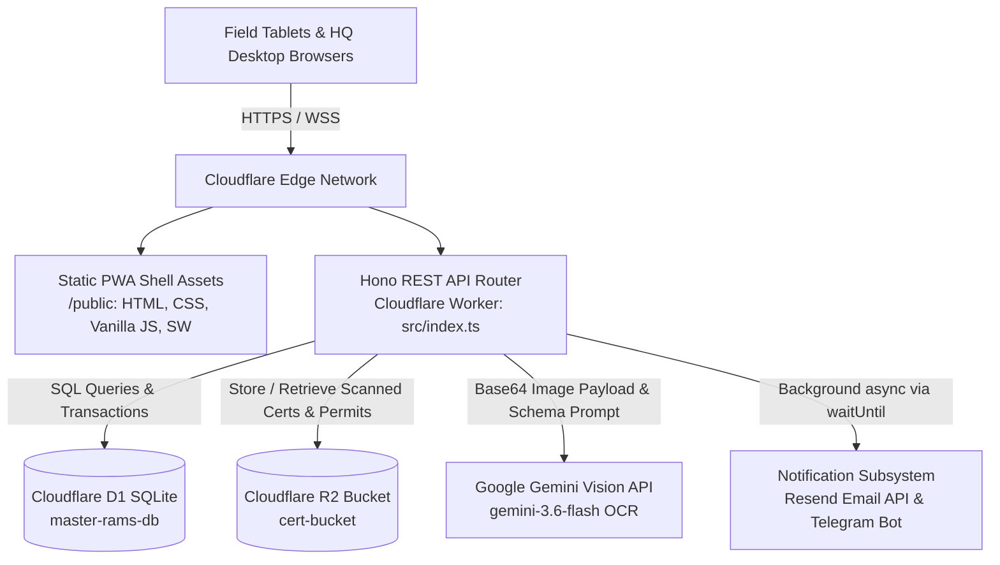
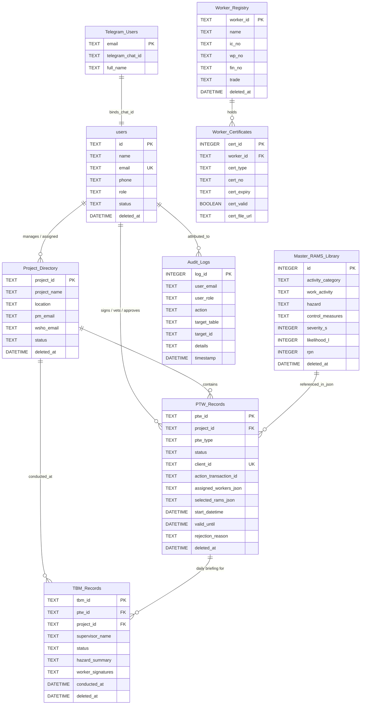
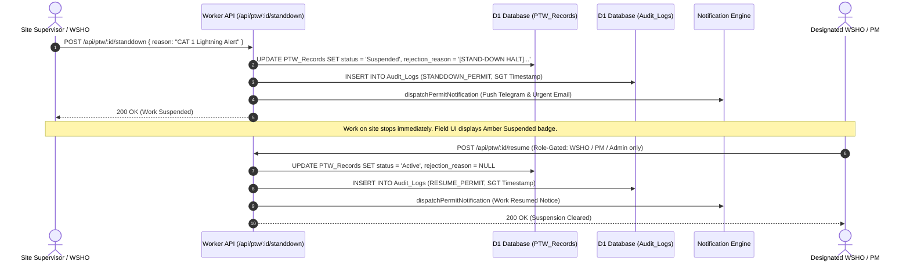
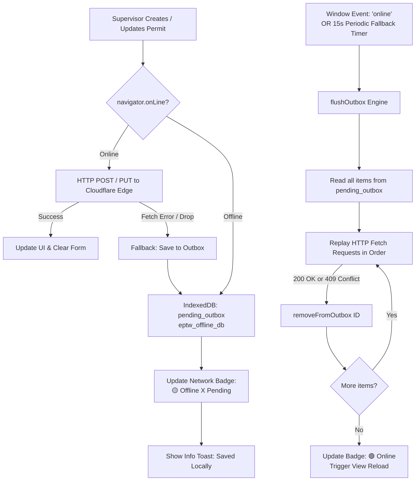

# Comprehensive System Architecture Summary: Electronic Permit-to-Work (ePTW) System

This architectural summary documents the production design, deployed infrastructure, data schemas, access controls, and core operational lifecycles of the **Singapore ePTW (Electronic Permit-to-Work) System**.

---

## 1. Tech Stack & Infrastructure

The ePTW system is engineered as an edge-native, serverless Progressive Web Application (PWA) running on Cloudflare's global edge network.



### 1.1 Core Components

| Technology / Component | Role & Deployed Implementation |
| :--- | :--- |
| **Cloudflare Workers** | **Edge Serverless Compute Engine** (`src/index.ts`). Executes low-latency request handling at edge nodes closest to Singapore (`Asia/Singapore`). Uses `safeWaitUntil` for non-blocking notifications. |
| **Cloudflare D1 (SQLite)** | **Edge Relational Database** (`master-rams-db`, binding: `DB`). Provides ACID compliance, atomic write transactions, foreign key enforcement, and indexes for permit numbers and timestamps. |
| **Cloudflare R2 Storage** | **S3-Compatible Zero-Egress Object Store** (`cert-bucket`, binding: `CERT_BUCKET`). Stores scanned NRICs, Ministry of Manpower (MOM) Work Permits, FIN cards, and WSQ safety certifications. Served via `/api/certs/:key` and `/api/files/:filename`. |
| **Hono Framework** | **Lightweight TypeScript Web Framework** (`v4.0.0`). Handles micro-routing, parameter parsing, CORS, header-based authentication, and JSON responses with near-zero cold start. |
| **Google Gemini Vision OCR** | **Multimodal AI Card & Certificate Extraction** (`gemini-3.6-flash`). Processes uploaded certificate images via `inlineData` base64 encoding to parse worker identification, course accreditation, certificate numbers, and expiry dates into structured JSON. |
| **Resend & Telegram Subsystems** | **Multichannel Dispatch Engine** (`src/notifications.ts`). Dispatches HTML alert emails via Resend REST API and instant push notifications to safety officers via a 1-tap paired Telegram bot webhook (`/api/telegram/webhook`). |

---

## 2. Database Schema & Data Models

The relational schema is defined across 9 tables in Cloudflare D1 with soft-delete capabilities (`deleted_at`), UUID/client-side idempotency keys, and indexing.



### 2.1 Table Breakdown

1. **`users`**:
   - Central identity directory storing all system participants with their strict role enumerations (`SITE_SUPERVISOR`, `SAFETY_ASSESSOR`, `WSHO`, `PROJECT_MANAGER`, `ADMIN`, `WORKER`).
2. **`Project_Directory`**:
   - Registry of construction worksites, physical locations, client details, assigned Project Manager (`pm_email`, `pm_user_id`), and designated WSHO (`wsho_email`, `wsho_user_id`).
   - Supports both hard deletion (for empty sites with 0 permits/TBMs) and compliance archiving (`status = 'Archived'`, `deleted_at = SGT`).
3. **`Master_RAMS_Library`**:
   - Risk Assessment and Method Statement repository compliant with MOM WSH (Risk Management) Regulations.
   - Computes Risk Priority Number: $\text{RPN} = \text{Severity } (1\text{--}5) \times \text{Likelihood } (1\text{--}5)$.
4. **`Worker_Registry`**:
   - Normalized worker profiles containing legal identification numbers: Singapore NRIC (`ic_no`), MOM Work Permit (`wp_no`), or Foreign Identification Number (`fin_no`), plus trade specialization.
5. **`Worker_Certificates`**:
   - 1-to-many child table of `Worker_Registry`. Stores individual qualifications (e.g., *WSQ Supervise Safe Lifting Operation*, *Work at Height for Supervisors*, *SOC Safety Course*) with validity flags and direct Cloudflare R2 file URLs (`cert_file_url`).
6. **`PTW_Records`**:
   - Core permit transactions. Tracks the lifecycle (`Draft` $\rightarrow$ `Pending Safety Vetting` $\rightarrow$ `Pending PM Approval` $\rightarrow$ `Active` $\rightarrow$ `Suspended` $\rightarrow$ `Closed` / `Cancelled`).
   - Stores denormalized JSON snapshots of selected RAMS controls (`selected_rams_json`) and certified workers (`assigned_workers_json`), high-resolution base64 signature strings, and client idempotency identifiers (`client_id`, `action_transaction_id`).
7. **`TBM_Records`**:
   - Pre-shift Toolbox Meeting briefings. Idempotently created upon permit activation per shift date (`DATE(conducted_at)`).
   - Captures supervisor signatures, dynamic hazard summaries inherited from the parent PTW, worker safety concerns raised, and an array of individual worker attendance signatures (`worker_signatures` JSON).
8. **`Audit_Logs`**:
   - Append-only, immutable event ledger tracking system mutations (permit submission, vetting, approval, emergency stand-down, closure, archival) with Singapore SGT timestamps and identity attribution.
9. **`Telegram_Users`**:
   - Mapping between user email accounts and Telegram Chat IDs for real-time bot alerting, paired via base64url one-time tokens.

---

## 3. Frontend Architecture & Three-Tier Portal System

The frontend architecture uses vanilla ES6 modules with no build-step overhead, styled with high-performance CSS and optimized for distinct operating environments:

```
                          ┌───────────────────────────────┐
                          │          login.html           │
                          │   Central Gateway & Router    │
                          └───────────────┬───────────────┘
                                          │
                        Role Inspection & Session Init
                                          │
                 ┌────────────────────────┴────────────────────────┐
                 │                                                 │
    role == 'SITE_SUPERVISOR'                      role != 'SITE_SUPERVISOR'
                 │                                                 │
        ┌────────▼───────────────┐                       ┌─────────▼───────────────┐
        │    supervisor.html     │                       │       index.html        │
        │ Mobile Kiosk UI (Field)│                       │  HQ Command Dashboard   │
        └────────────────────────┘                       └─────────────────────────┘
```

### 3.1 Portal Specifications

#### 1. `login.html` — Central Authentication Gateway
- **Purpose**: Authenticates credentials, displays active role preview, and acts as the entry point.
- **Session Management**: Writes `active_user_email`, `active_user_name`, and `active_user_role` into `localStorage`.
- **Smart Routing**:
  - `SITE_SUPERVISOR` $\rightarrow$ Redirects to `/supervisor.html`.
  - `WSHO`, `PROJECT_MANAGER`, `SAFETY_ASSESSOR`, `ADMIN` $\rightarrow$ Redirects to `/index.html`.
- **Account Switcher**: Supports `?logout=true` and `?switch=true` URL parameters to clear session tokens cleanly.

#### 2. `supervisor.html` — Light-Mode Mobile Kiosk
- **Purpose**: Field portal optimized for rugged site tablets (iPad / Android / Surface) operating outdoors.
- **UX Engineering**: High-contrast, sunlight-readable light theme (`#f8fafc` background, crisp dark typography, large 48px+ touch targets).
- **Core Views**:
  - **Site Picker**: Remembers site selection via `supervisor_active_project_id`.
  - **Permit Creator**: Work description input, dynamic RAMS hazard checklist, worker qualification badges, and HTML5 canvas signature pad.
  - **Field Permits List**: Instant visual state pills (`Draft`, `Pending`, `Active`, `Suspended`), with direct action buttons (Edit Draft, Submit, Trigger Stand-Down).
- **Guard Logic**: Enforces `activeRole === 'SITE_SUPERVISOR'`. If an administrative role accesses `supervisor.html`, it allows in-place role switching or redirects to `index.html`.

#### 3. `index.html` — HQ Command Dashboard
- **Purpose**: Desktop/workstation control center for safety officers, project executives, and auditors.
- **Tabbed Interface**:
  - **Tab 1 — RAMS Library**: Matrix sorting, RPN dynamic calculator ($S \times L$), full CRUD for safe work procedures.
  - **Tab 2 — Worker Registry & OCR**: Drag-and-drop certificate uploader connected to Gemini Vision AI, worker skill matrix, cert expiration monitors.
  - **Tab 3 — Project Directory**: Project site creator, provisional site approval, PM/WSHO user linking, archival tools.
  - **Tab 4 — Permit-to-Work**: Multi-stage vetting modal, side-by-side signature inspection, permit approval, permit suspension, and de-isolation verification.
  - **Tab 5 — TBM Daily Briefings**: Shift briefing review, attendance audits, signed worker list.
  - **Tab 6 — Audit Logs**: MOM compliance ledger, exportable records, multi-parameter search (user, action, target table, date range).
- **Guard Logic**: Blocks `SITE_SUPERVISOR` sessions and redirects them to `supervisor.html`.

---

## 4. Role-Based Access Control (RBAC) & Data Isolation

Permissions and isolation rules are enforced across client routing guards and server API handlers:

| Role | Client Portal | Permitted API Operations | Restricted Operations |
| :--- | :--- | :--- | :--- |
| **`SITE_SUPERVISOR`** | `supervisor.html` | • Create/Edit Draft PTW (`POST /api/ptw`)<br>• Submit PTW for Vetting<br>• Sign pre-shift TBM Briefings (`POST /api/tbm/:id/sign`)<br>• Trigger Emergency Stand-Down (`POST /api/ptw/:id/standdown`) | • Cannot vet or approve permits<br>• Cannot resume suspended permits<br>• Cannot modify RAMS library<br>• Cannot archive or delete projects |
| **`WSHO`** | `index.html` | • Safety Vetting of PTW (`POST /api/ptw/:id/vet`)<br>• Trigger Emergency Stand-Down (`POST /api/ptw/:id/standdown`)<br>• Clear Stand-Down & Resume Permit (`POST /api/ptw/:id/resume`)<br>• Upload & run Gemini OCR (`POST /api/workers/upload`)<br>• Maintain Worker Registry & RAMS Library | • Cannot issue final PM Approval (`/api/ptw/:id/approve`)<br>• Cannot perform financial project deletion |
| **`PROJECT_MANAGER`** | `index.html` | • Final Approval of Vetted PTW (`POST /api/ptw/:id/approve`)<br>• Final Permit Closure & Deisolation (`POST /api/ptw/:id/close`)<br>• Clear Stand-Down & Resume Permit (`POST /api/ptw/:id/resume`)<br>• Create & Archive Projects (`POST /api/projects`, `DELETE /api/projects/:id`) | • Cannot bypass Safety Vetting stage<br>• Cannot falsify worker certifications |
| **`ADMIN` / `SAFETY_ASSESSOR`** | `index.html` | • Full Governance & User Management (`/api/users`)<br>• Audit Trail Ingestion & Inspection (`GET /api/audit-logs`)<br>• System-wide override to resume or cancel permits<br>• Provisional project clearance | • Cannot delete non-empty projects without archival cascade |

### RBAC Enforcement in Code
All API mutations inspect the `X-User-Role` and `X-User-Email` HTTP headers:
- In `/api/ptw/:id/resume`, the server evaluates:
  ```typescript
  if (userRole !== 'WSHO' && userRole !== 'PROJECT_MANAGER' && userRole !== 'ADMIN' && userRole !== 'SAFETY_ASSESSOR') {
    return c.json({ success: false, error: 'Access Denied: Only WSHO or Project Manager can clear work suspensions.' }, 403);
  }
  ```
- In `/api/projects/:id` deletion, the server enforces referential integrity: if active permits or TBM records exist, hard delete is blocked, prompting compliance archival instead.

---

## 5. Core Workflows

### 5.1 Emergency Stand-Down Lifecycle (Weather / Safety Halt)

The ePTW system incorporates a safety mechanism for immediate site-wide or task-specific work halts (e.g., NEA CAT 1 Lightning Warnings, heavy monsoon downpours, or observed structural instability).



1. **Trigger**: Any field supervisor or safety officer triggers a Stand-Down via `/api/ptw/:id/standdown`.
2. **State Transition**: Status shifts from `Active` to `Suspended`. The rejection reason is prepended with `[STAND-DOWN HALT]`.
3. **Audit Immutability**: Writes a `STANDDOWN_PERMIT` event containing the user's role and reason to `Audit_Logs`.
4. **Instant Notification**: Non-blocking edge execution dispatches broadcast alerts to both supervisor and WSHO.
5. **Strict Clearance**: Only a qualified `WSHO`, `PROJECT_MANAGER`, or `ADMIN` can clear the halt via `/api/ptw/:id/resume`. Supervisors cannot resume their own suspended permits.

---

### 5.2 Offline Outbox Caching for Field Tablets

To operate in basement levels, offshore locations (e.g., Jurong Island), or concrete structures without Wi-Fi/4G, the application uses an IndexedDB Outbox Engine (`public/assets/js/db.js`).



1. **Storage Subsystem**: Dedicated client-side IndexedDB database `eptw_offline_db` with an object store `pending_outbox`.
2. **Idempotency Guarantee**: Every offline payload is stamped with a persistent UUID (`client_id` or `action_transaction_id`). The server enforces `UNIQUE INDEX idx_ptw_client_id`—preventing duplicate permits upon re-sync.
3. **Signature Compression**: Canvas signatures are rasterized into lightweight base64 PNG data (~15KB) prior to transaction serialization, keeping IndexedDB memory footprints low.
4. **Dual-Layer Auto-Sync**:
   - Primary: Listens to the browser `window.addEventListener('online')` trigger.
   - Secondary: 15-second polling fallback interval to combat silent connection drops on iOS Safari and Android Chrome kiosks.
5. **Graceful Conflict Handling**: If an outbox request returns HTTP 409 (already recorded by backend), the item is safely evicted from the outbox queue without throwing user errors.

---

### 5.3 Immutable SGT-Timestamped Audit Trails

To comply with Singapore Ministry of Manpower (MOM) audits and the Workplace Safety and Health Act, all mutations are captured in `Audit_Logs`.

```typescript
// Explicit SGT (UTC+8) Formatter in Cloudflare Worker runtime
function getSingaporeTimestamp(): string {
  const now = new Date();
  const formatter = new Intl.DateTimeFormat('en-CA', {
    timeZone: 'Asia/Singapore',
    year: 'numeric',
    month: '2-digit',
    day: '2-digit',
    hour: '2-digit',
    minute: '2-digit',
    second: '2-digit',
    hour12: false
  });
  const parts = formatter.formatToParts(now);
  const getVal = (type: string) => parts.find(p => p.type === type)?.value || '00';
  return `${getVal('year')}-${getVal('month')}-${getVal('day')} ${getVal('hour')}:${getVal('minute')}:${getVal('second')}`;
}
```

#### Non-Repudiation Architecture
- **Header Injection**: Client API calls automatically attach `X-User-Email` and `X-User-Role` from authenticated storage.
- **Payload Verification**: If headers are missing, the server extracts identity parameters from the signed request body or falls back to system context.
- **Audit Ledger Fields**:
  - `log_id`: Auto-incrementing primary key.
  - `user_email`: Full authenticated email of the actor.
  - `user_role`: System role held at the moment of execution.
  - `action`: Specific operation code (`CREATE_PTW`, `VET_PTW`, `APPROVE_PTW`, `STANDDOWN_PERMIT`, `RESUME_PERMIT`, `CLOSE_PTW`, `ARCHIVE_PROJECT`).
  - `target_table` & `target_id`: Entity reference (`PTW_Records`, `PRJ-001`).
  - `details`: Human-readable summary of parameters, comments, and safety reasons.
  - `timestamp`: Immutable Singapore SGT timestamp (`YYYY-MM-DD HH:MM:SS`).
- **Audit Portal Inspection**: Accessible under **Tab 6** of `index.html`, offering filterable search queries directly to MOM inspectors and corporate safety directors.

---

## 6. Architecture Verification Summary

| Feature / Requirement | Current Codebase Implementation Status |
| :--- | :--- |
| **Serverless Edge Backend** | Cloudflare Workers TypeScript bundle (`src/index.ts`, `src/notifications.ts`) routed via Hono REST API. |
| **Persistent Storage** | Cloudflare D1 SQLite (`b4b001b1-a00c-4bb5-ad57-340bcb18cdda`) + Cloudflare R2 bucket (`cert-bucket`). |
| **AI Vision OCR** | Google Generative AI (`gemini-3.6-flash:generateContent`) with JSON schema enforcement for IC/Work Permit/WSQ cards. |
| **Three-Tier Portals** | `public/login.html` (gateway), `public/supervisor.html` (light-mode tablet kiosk), `public/index.html` (HQ admin control center). |
| **Role-Based Guards** | Role check in `login.js`, `app.js`, and `supervisor.js`; server-level header validation for permit vetting and resume operations. |
| **Resilience & Offline** | IndexedDB (`pending_outbox`), UUID idempotency deduplication, and dual-layer auto-sync listeners in `db.js`. |
| **Legal Compliance** | Mandatory de-isolation checks upon closure, SGT UTC+8 audit logging, and soft deletion (`deleted_at`) preserving regulatory records. |

